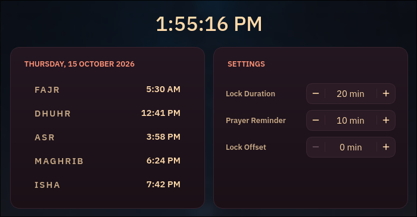
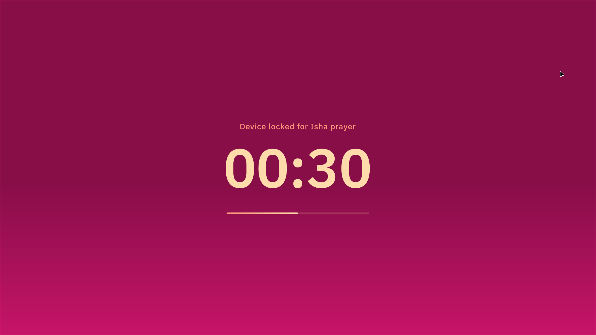

# prayer-pause

A small desktop app that runs in the background and locks your screen for a few minutes when it is time to pray.

It works on Linux and Windows (Tested on Windows 11 and Arch Linux, although should work on most Linux distros).

<p align="center">
  
  
</p>

## What it does

- Finds your city from your IP address.
- Gets daily prayer times from the [AlAdhan API](https://aladhan.com/prayer-times-api) and save them on your computer.
- Locks the screen at each prayer time with a countdown.
- Lives in the system tray (Click **Show** to see today's times and change settings, or **Quit** to close it).

## Installing

- Get the latest binary (Linux) or exe (Windows) file from the [Releases](https://github.com/cqveman/prayer-pause/releases) page.

## Building from source

You need Python 3.14 or newer.

```bash
git clone https://github.com/cqveman/prayer-pause.git
cd prayer-pause
python -m venv .venv
source .venv/bin/activate      # Windows: .venv\Scripts\activate
```

The app is packaged with `nuitka`. Build on the system you want to run it on.

```bash
pip install -e .
python -m nuitka deploy.py
```

The finished build is in `/deployment`.

If you want to just run it from the source:

```bash
pip install -e . # If not installed yet
python src/prayer_pause/main.py
```

## Settings

Change these from the **Show** window:

| Setting | Default | Meaning |
|---|---|---|
| Lock Duration | 20 min | How long the screen stays locked |
| Prayer Reminder | 10 min | Time before a prayer to remind you |
| Lock Offset | 0 min | Shift for the lock time |

Settings are saved here:

- Linux: `~/.config/prayer-pause/prayer-pause.json`
- Windows: `%APPDATA%\prayer-pause\prayer-pause.json`

Saved prayer times are kept here:

- Linux: `~/.cache/prayer-pause/prayer_times.json`
- Windows: `%LOCALAPPDATA%\prayer-pause\prayer_times.json`

## Troubleshooting

- Check your date, time, and timezone.
- Check your internet connection. The app needs it the first time to get prayer times (and every 30 days).
- If settings look broken, delete the settings file. The app makes a new one with default values.

## Known limits

- Currently, on Hyprland, the lock screen only shows on the workspace it was opened on.
- No MacOS support.

## To do

- [ ] Start automatically on login (Linux and Windows)
- [ ] Fix the locker offset functionality
- [ ] Use a custom font instead of the OS's
- [ ] Automate the building process using GitHub Workflows
- [ ] Lock screen on all workspaces (Hyprland)

## License

MIT
